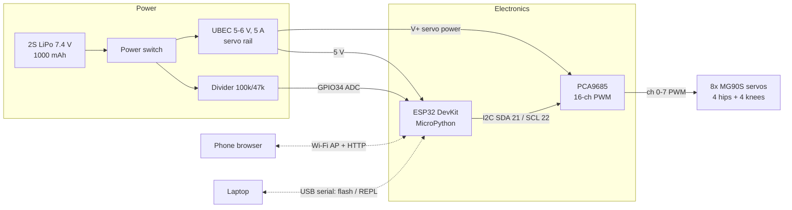
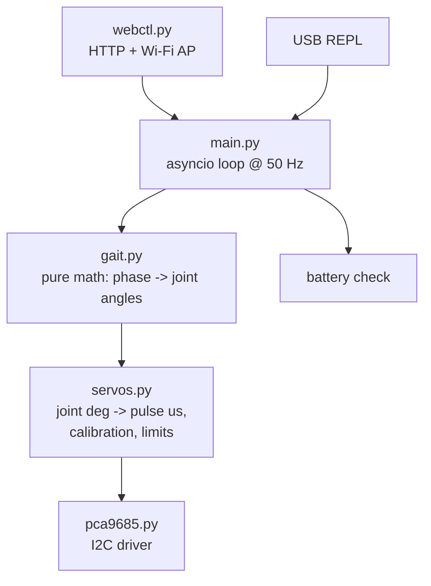

# Walker robot: architecture

A small four-legged walking robot (the "crab"; two other styles, a 6-legged hexapod and a windmill rover with spinning spoked legs, are described in [styles.md](styles.md)). Every structural part is 3D printed on a Bambu P1S
with the AMS. An ESP32 runs MicroPython and drives 8 hobby servos through a PCA9685
PWM board. Control is over Wi-Fi from a phone browser, or over USB serial.

| Spec | Target |
|---|---|
| Legs / degrees of freedom | 4 legs x 2 joints (hip yaw + knee lift) = 8 servos |
| Footprint | ~120 x 120 mm standing (body ~100 x 70 mm) |
| Mass | ~250-300 g with battery |
| Gait | 4-beat creep (wave) gait: one leg in the air at a time, 3 always on the ground |
| Speed | ~2-4 cm/s (slow and stable on purpose) |
| Runtime | ~20-40 min on a 2S 1000 mAh LiPo |
| Control | Phone browser over Wi-Fi (robot is its own access point), or USB REPL |
| Parts cost | ~$40-60 (see [components.md](components.md)) |

**Building this with a child?** See [kid-edition.md](kid-edition.md) for the micro:bit / AA-battery / no-soldering version.

Simpler alternative: a 2-servo "shuffle" walker (one servo tilts the body side to side,
one swings the legs). It's cheaper and easier to build but walks crudely. The firmware's
layered design ports to it by changing `config.py` and `gait.py`.

## System block diagram



## Subsystems

**Mechanical** ([mechanical.md](mechanical.md)). The chassis is a printed tray holding the 4 hip
servos, the electronics and the battery. Each leg is two printed links: a *coxa* bracket on
the hip servo horn that carries the knee servo, and a *femur/foot* on the knee servo horn.
Parts come from parametric Python CAD in `cad/` and are packaged as multi-material 3MFs:
body in filament 1, accents and foot pads in filament 2 (TPU pads are an option).

**Electrical** ([wiring.md](wiring.md)). The servos run on their own 5-6 V high-current rail
from a UBEC. They never draw power from the ESP32's regulator, because 8 servos can pull
several amps at stall. Everything shares a common ground. A resistor divider lets the ESP32
watch battery voltage and stop walking before the LiPo is over-discharged.

**Firmware** ([../firmware/](../firmware/)). Layered so that everything except the hardware
driver runs and is unit-tested on a normal computer:



**Gait.** Each leg follows the same cycle, shifted by a quarter period, in the order
RR -> FR -> RL -> FL. In its quarter, a leg lifts, swings its hip forward and plants. During
the other three quarters it sweeps slowly backward, which moves the body forward. Turning
gives the two sides opposite sweep directions. Walking backward runs the cycle in reverse.

## Pipeline fit

```
cad/*.py  ->  multi-material .3mf  ->  Bambu Studio slice  ->  printer/bambu_send.py  ->  P1S + AMS
firmware/src/*.py  ->  mpremote copy  ->  ESP32
```

## Key decisions

| Decision | Choice | Why |
|---|---|---|
| Microcontroller | ESP32 DevKit (WROOM-32) | Wi-Fi built in, ~$5-8, runs MicroPython, plenty of GPIO/ADC |
| Language | MicroPython | No compile step; edit, copy, run; REPL for calibration |
| Servo driver | PCA9685 over I2C | Jitter-free hardware PWM for 16 channels; takes only 2 pins |
| Servos | MG90S (metal gear) | Same size as SG90 but sturdier gears; ~2.0 kg·cm |
| Battery | 2S LiPo + UBEC | Enough current headroom; the UBEC isolates servo noise |
| Kinematics | 2-DOF legs, hip yaw + knee lift | Simplest layout that can walk statically stably and turn |

## Open questions / next steps

1. Parametric CAD for chassis, coxa and femur (`cad/walker/`), sized to the MG90S drawing in mechanical.md.
2. Print a single leg first to check servo fit and horn interface before printing all four.
3. Calibrate servo neutrals (`firmware/src/calibrate.py`), then tune stride and lift.
4. Later: IMU (MPU6050) for tilt feedback, or an upgrade to 3-DOF legs (12 servos, still fits on the PCA9685).
